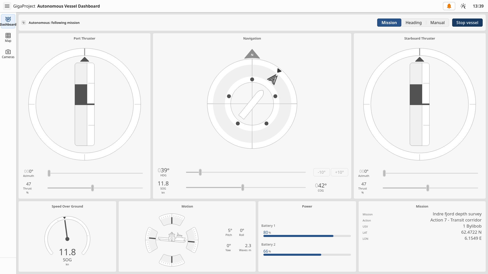

# GigaProject Dashboard

A dashboard for an autonomous surface vessel, built for a course and as a way to get familiar with the [OpenBridge](https://github.com/Ocean-Industries-Concept-Lab/openbridge-webcomponents) design system. It runs on mock data and isn't connected to a real vessel.

